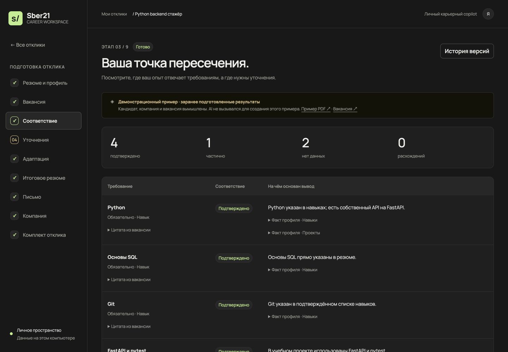
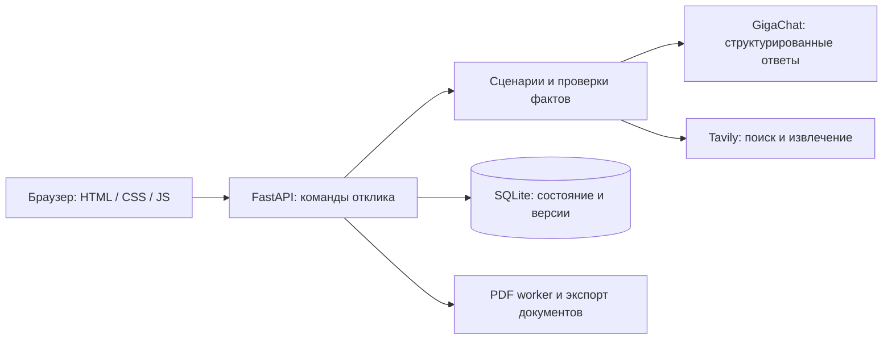

# Career Advisor

**От исходного резюме — к осмысленному отклику на конкретную вакансию.**

В интерфейсе сохранено историческое название **Sber21**.

Локальный AI-помощник: выделяет факты из резюме, сопоставляет их с требованиями, предлагает адаптацию текста и помогает подготовиться к разговору с работодателем. Пользователь проверяет факты и принимает каждую правку перед сборкой документов.



> Пет-проект для личного использования и портфолио. Интерфейс — на русском. Приложение запускается на вашем компьютере; локальное хранение не исключает передачу выбранных данных провайдерам при запуске AI и поиска.

## Какую задачу решает

Один и тот же опыт можно описать по-разному для разных ролей. При этом легко скопировать формулировки вакансии, добавить неподтверждённые навыки или потерять связь между правкой и реальным опытом.

Career Advisor строит отклик вокруг проверяемых фактов: **требование → основание в профиле → предложение → решение пользователя**. Общего «процента соответствия» и обещания трудоустройства здесь нет.

## Что умеет

| Этап | Результат |
| --- | --- |
| Резюме и профиль | Текст из PDF или вставки; факты с исходными фрагментами и ручным подтверждением |
| Вакансия | Название, работодатель, требования, обязательность и цитаты из описания |
| Соответствие | Отдельный вывод по каждому требованию: подтверждено, частично, нет данных или есть расхождение |
| Уточнения | До четырёх вопросов; ответы становятся фактами только после подтверждения |
| Адаптация | Содержательные правки «до/после», объяснения и основания; каждую можно принять или отклонить |
| Документы | Редактируемое резюме, PDF/DOCX и сопроводительное письмо в TXT |
| Компания | Поиск публичных материалов, отчёт с источниками, неизвестными сведениями и вопросами на интервью; экспорт Markdown |
| История | Локальное сохранение, версии отклика и восстановление предыдущего состояния |

В адаптации AI может перестроить абзацы, выделить личный вклад и собрать существующий раздел «О себе» из нескольких подтверждённых фактов. Учебный проект не должен превращаться в коммерческий, исследование API — в готовую интеграцию, а количество ошибок — в выдуманный процент улучшения. Программные проверки закрывают часть таких ошибок, остальные требуют просмотра человеком.

## Попробовать за несколько минут

Проверенное окружение: **Python 3.14, macOS**. Отдельная сборка интерфейса, Node.js и внешняя база данных для запуска не нужны.

Из корня репозитория:

```sh
cd final
python3.14 -m venv .venv
source .venv/bin/activate
python -m pip install -r requirements-tested.txt
python -m uvicorn web_app:app --host 127.0.0.1 --port 8766 --no-access-log
```

Откройте **http://127.0.0.1:8766/** и нажмите **«Попробовать демо»**. Кандидат, компания и вакансия вымышлены; результаты подготовлены заранее. Для демо не нужны ключи API, и его создание не вызывает модель.

Чтобы пройти демо без провайдеров: посмотрите соответствие → пропустите уточнения → примите или отклоните готовую правку → соберите и подтвердите резюме → подтвердите письмо → скачайте комплект.

**Кнопки AI даже внутри демо запускают настоящую обработку**, а не воспроизводят сохранённый ответ. Для остановки сервера нажмите **Control + C** в терминале.

Подробности: [самостоятельный запуск](final/RUN_LOCAL_RU.md) · [демосценарий](final/demo/README.md).

## Подключить AI и поиск

Из каталога `final`, если `.env` ещё не существует:

```sh
python -c "from pathlib import Path; p=Path('.env'); p.exists() or p.write_text(Path('.env.example').read_text())"
```

Откройте созданный `.env` в редакторе и заполните:

- `GIGACHAT_CREDENTIALS` — ключ авторизации GigaChat;
- `GIGACHAT_MODEL` — модель, доступная вашему аккаунту;
- `GIGACHAT_SCOPE` — тип аккаунта; для персонального обычно `GIGACHAT_API_PERS`;
- `TAVILY_API_KEY` — ключ поиска и извлечения публичных страниц.

После изменения настроек перезапустите сервер. Ключи остаются на стороне Python и не передаются в интерфейс. AI получает необходимые для этапа данные после явного запуска пользователем. Для исследования работодателя используются публичное название компании, необязательный сайт, название роли и найденные материалы; резюме и ответы кандидата в исследование не включаются.

Новый поиск работодателя: до **6 поисковых запросов**, **2 запросов извлечения страниц** и **2 AI-задач**. Подготовка отчёта по уже сохранённым источникам: до **1 AI-задачи**, без нового поиска. Это может расходовать лимиты провайдеров.

## Как устроено



Это один локальный Python-сервис с явными сценариями. Каждый отклик — версионируемый объект. Изменение исходных фактов сбрасывает зависимые текущие результаты; старые состояния остаются в истории. Проверка версии защищает от незаметной перезаписи данных из другой вкладки.

**[Гайд по архитектуре](docs/ARCHITECTURE.md)** объясняет весь путь одного нажатия, назначение файлов, работу с AI, базой и документами. **[ТЗ продукта](docs/PRODUCT_SPEC.md)** фиксирует сценарии и критерии приёмки для совместной разработки. [Технические настройки и API](final/README.md) — для работы с реализацией.

## Стек

- **Backend:** FastAPI, Pydantic, SQLite.
- **AI:** GigaChat через LangChain; типизированные входы и ответы.
- **Поиск:** Tavily, фильтрация работодателя и очистка найденных фрагментов.
- **Документы:** pypdf в отдельном процессе, ReportLab, python-docx.
- **Frontend:** HTML, CSS, JavaScript-модули; шрифт Manrope хранится локально.

Модель не обучается на резюме. Это прикладная интеграция LLM, поиска и проверяемого workflow; обучающего датасета и заявленной метрики точности модели нет.

## Проверки

Из `final` с активированным окружением:

```sh
python -B -m unittest discover -s tests -q
python -m pip check
```

Тесты используют синтетические данные, временные базы и подмены провайдеров. Они проверяют подтверждение фактов, ссылки на основания, частичное восстановление ошибочных ответов, ручные решения, версии, экспорт и работу поиска при сбоях. Обычный запуск тестов не делает платных запросов.

Состояние проверок и границы живой оценки: **[VERIFICATION.md](final/VERIFICATION.md)**. Качество переписывания резюме и вероятность найма численно не измерялись.

## Ограничения

- Только локальный запуск для одного пользователя: без регистрации, изоляции аккаунтов и готовности к публичному размещению.
- PDF должен содержать текстовый слой: до 10 МБ, до 20 страниц. OCR не реализован.
- Изолированный PDF-процесс использует Unix-ограничения; Windows пока не поддерживается. Linux отдельно не проверен в этой версии.
- Проверяемая цитата подтверждает происхождение текста, но не истинность интерпретации AI. Все итоговые документы требуют проверки.
- Поиск может не различить одноимённых работодателей или не найти сведения. Указание официального сайта помогает; неизвестное не заменяется догадками.
- Нет автоматической отправки откликов, массового отклика и гарантии прохождения ATS или найма.

## Данные и права

Локальные отклики и версии находятся в `final/data/career.sqlite3`. Они, `.env`, сгенерированные документы и окружения исключены из Git. Демофайлы используют вымышленные сведения и адреса `example.com`.

Разработка велась с активным использованием AI-инструментов. Это часть процесса создания проекта, а не заявление об автономной разработке модели или измеренной эффективности подбора персонала.

**Все права сохранены.** Свободная лицензия на исходный код не предоставляется. Условия публикации на GitHub и права сторонних компонентов описаны в [COPYRIGHT.md](COPYRIGHT.md) и [THIRD_PARTY_NOTICES.md](THIRD_PARTY_NOTICES.md).
