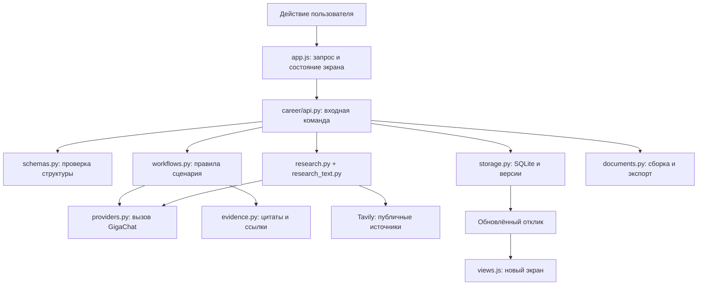
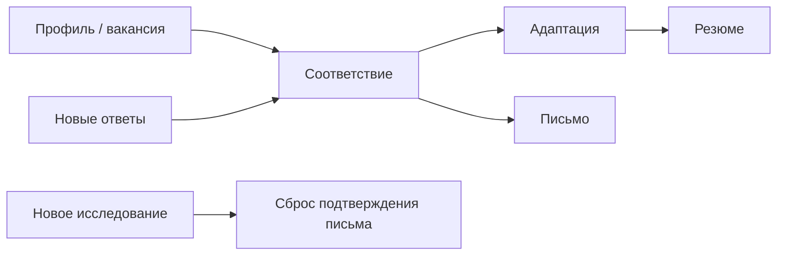

# Архитектура Career Advisor: как разобраться в проекте

Этот гайд можно читать без опыта backend-разработки. Цель — понимать, где находится логика продукта, как данные проходят через приложение и почему оно устроено именно так.

## 1. Главная идея

Приложение хранит **отклик на конкретную вакансию**. У отклика есть исходное резюме, подтверждённые факты, требования, результаты сравнения и документы. AI помогает заполнить или преобразовать эти данные; решения о достоверности и принятии правок остаются у пользователя.

Это **модульный монолит**: один Python-процесс обслуживает интерфейс и API. Модули разделены по ответственности, но не являются отдельными сервисами. Для личного приложения это позволяет обойтись без отдельного сервера базы, очереди задач и распределённой инфраструктуры.

Историческое название каталога приложения — `final`. Оно не означает, что развитие завершено. Старые CLI/Telegram-прототипы не входят в текущую версию. LangGraph и старый универсальный чат из исполняемого сценария убраны; переходы между шагами задаёт обычный Python-код.

## 2. Карта приложения

Практический перевод: браузер показывает данные и отправляет команды; Python проверяет правила и сохраняет результат; AI возвращает предложение определённой структуры.

## 3. Где искать код

| Файл | Его задача | Когда сюда смотреть |
| --- | --- | --- |
| `final/web_app.py` | Создать FastAPI-приложение, подключить маршруты, статические файлы и защитные заголовки | Приложение не открывается, нужно изменить точку входа |
| `final/app_config.py` | Прочитать локальные настройки и создать клиент модели | Настройка GigaChat, таймауты, модель, сертификаты |
| `final/web/static/app.js` | Обработка нажатий, HTTP-запросы, состояние экрана, несохранённый ввод | Что происходит после кнопки |
| `final/web/static/views.js` | Разметка каждого этапа из полученного отклика | Какие данные и действия видит пользователь |
| `final/web/static/app.css` | Тёмная тема, размеры, расположение, мобильный интерфейс | Внешний вид |
| `final/career/schemas.py` | Pydantic-контракты фактов, требований, правок, отчёта и отклика | Добавление поля, ограничения структуры |
| `final/career/api.py` | HTTP-команды, проверки версии, защита от параллельных операций, сохранение | Новое пользовательское действие |
| `final/career/workflows.py` | Извлечение, соответствие, уточнения зависимостей, правки, письмо | Изменение поведения продукта |
| `final/career/resume_strategy.py` | Инструкция для глубокой адаптации резюме | Изменение редакторской стратегии AI |
| `final/career/providers.py` | Общая точка обращения к модели, семафор, валидация URL | Внешний сервис или общий лимит AI |
| `final/career/evidence.py` | Проверка цитат, фрагменты исходника, короткие ID для модели | Ошибки в основаниях AI |
| `final/career/research.py` | Поиск компании, планирование запросов, подготовка отчёта, экспорт Markdown | Исследование работодателя |
| `final/career/research_text.py` | Связь страницы с работодателем, очистка, отбор фрагментов | Мусор и неподходящие страницы в поиске |
| `final/career/storage.py` | Транзакции SQLite, снимки версий, история запусков | Сохранение, восстановление, конфликт вкладок |
| `final/career/documents.py` | Сборка принятого текста и экспорт PDF/DOCX | Содержимое и оформление документов |
| `final/career/pdf_worker.py` | Извлечь текст PDF в отдельном ограниченном процессе | Чтение PDF, лимиты и ошибки файлов |
| `final/career/demo.py`, `final/demo/` | Создать независимый отклик из вымышленного примера | Знакомство с продуктом без API |
| `final/tests/` | Проверки сценариев с временными базами и подменами AI | Проверка изменений |

## 4. Что хранится в отклике

`Application` в `schemas.py` — главный объект. Это не пользовательский аккаунт, а одна подготовка к одной вакансии.

- **Fact:** текст о кандидате, раздел резюме, исходное основание, происхождение и ID.
- **Requirement:** формулировка требования, цитата, категория и обязательность.
- **Finding:** связь требования с фактами; статус, объяснение, необходимость ручной проверки.
- **Question:** уточнение по требованию, ответ и признак пропуска.
- **ResumeChange:** основной факт, исходный и новый текст, дополнительные основания, объяснение, решение пользователя.
- **ResearchResult:** утверждения по компании, источники, неизвестное, вопросы, статус отчёта.
- **Application:** всё перечисленное плюс исходники, документы, подтверждения, номер версии и время изменения.

Не путай два разных значения слова «факт»: текст, извлечённый моделью, ещё не становится подтверждённым профилем. Перед использованием пользователь подтверждает профиль целиком.

## 5. Путь одного нажатия: «Предложить правки»

1. `app.js` показывает, какие данные уйдут провайдеру, и получает подтверждение запуска.
2. Браузер отправляет `POST /api/applications/{id}/changes` с текущим `version`.
3. FastAPI проверяет структуру команды. `mutate()` в `api.py` загружает отклик и сверяет версию.
4. Для этого отклика ставится локальный признак занятости, а запуск записывается как `running`.
5. `propose_changes()` проверяет, что профиль и вакансия подтверждены и есть анализ соответствия.
6. Факты получают короткие имена `F01`, `F02` и т. д. Модель получает каталог, вакансию, выводы и инструкцию из `resume_strategy.py`.
7. `providers.structured()` вызывает GigaChat и ожидает ответ формата `ChangeResult`.
8. Сервер сопоставляет ссылки с реальными фактами. Неверные основания и неподтверждённые новые числа не превращаются в правки. Непригодные предложения исключаются с уведомлением.
9. Новые правки сохраняются с решением `pending`. Зависимые текущие документы сбрасываются: они ещё не учитывают новую адаптацию.
10. `storage.save()` атомарно сохраняет состояние и новую версию. Запуск получает статус `done`.
11. Браузер получает обновлённый отклик и рисует карточки «до/после».

**Важно:** на этом шаге резюме ещё не изменено. При сборке `assemble_resume()` подставляет только правки с решением `accepted`. Отклонённая правка сохраняет исходную формулировку.

## 6. Почему AI возвращает структуру

Человеку удобно читать абзац. Программе нужно знать, к какому факту относится правка и какие требования подтверждены. Поэтому у ответа есть поля и ограничения: Pydantic-модели превращаются в ожидаемую структуру ответа GigaChat через LangChain.

Это позволяет обнаружить отсутствующее поле или неверный тип. Но корректный JSON не гарантирует правильного смысла. Поэтому после разбора ответа идут проверки ссылок, исходных цитат, чисел и решений пользователя.

Здесь нет обучения модели, эмбеддингов или векторной базы. Данные текущего этапа передаются модели в запросе. Не нужно объяснять проект на собеседовании как собственную обученную нейросеть.

## 7. Как проверяются основания

### Резюме

Текст делится на короткие фрагменты `T01`, `T02` и т. д. AI возвращает факт с цитатой или ссылкой на фрагмент. Нормализация допускает типографские различия и разорванные PDF-слова, сохраняя исходный текст для просмотра. Пробелы между цифрами не склеиваются в новое число.

Если надёжного основания нет, предложение хранится отдельно как `profile_candidates`. Оно не участвует в сравнении. Пользователь может проверить его и добавить как своё утверждение.

### Соответствие

Модель видит короткие ссылки `R01` и `F01`, а сервер восстанавливает настоящие ID. Если одна ссылка неверна, эта строка становится `unknown` и требует проверки; корректные строки сохраняются. Отсутствие упоминания навыка не является доказательством отсутствия навыка.

График и формат работы нельзя подтвердить молчанием резюме. Для таких условий нужен отдельный ответ кандидата. Будущая обязанность также не означает автоматически подтверждённый прошлый опыт.

### Адаптация

Дополнительные факты можно использовать для «О себе» и навыков. Описание одного проекта не должно забирать достижения из другого. Все предложения остаются черновиками до принятия. Защита от новых чисел и процентов дополняет промпт, но не заменяет смысловую проверку.

## 8. Исследование компании — отдельный сценарий

1. Tavily ищет исходные сведения по названию компании и необязательному сайту.
2. По подходящим исходным фрагментам GigaChat составляет пять адресных запросов. Без подходящего исходного результата используются запасные запросы без этого AI-шага.
3. Выполняются дополнительные поиски по продуктам, задачам/технологиям, команде, новостям и интервью.
4. Проверяется связь результатов именно с работодателем. Для неоднозначного названия нужны признаки организации, а не простое совпадение слов.
5. Из выбранных страниц извлекается текст; сохраняются и полезные поисковые выдержки. Меню, рассылки и повторения очищаются локально.
6. Сервер присваивает коротким фрагментам ID вроде `S03-E2`.
7. AI пишет краткий отчёт, ссылаясь на эти ID. Источники, цитаты, даты и статус собирает сервер.
8. Если сводка не получилась, материалы остаются. Подготовку отчёта можно повторить без нового поиска.

В этот сценарий не передаются факты из резюме и ответы интервью. Тем не менее само название роли и публичные страницы передаются внешним провайдерам. Поиск не доказывает истинность отзыва или актуальность архивной вакансии.

## 9. База и версии

SQLite хранит три таблицы:

| Таблица | Содержимое |
| --- | --- |
| `applications` | Последняя версия каждого отклика в JSON и номер версии |
| `versions` | Полные снимки отклика после успешных изменений |
| `runs` | Этапы и статусы последних операций |

Почему JSON в SQLite: объект отклика небольшой, используется как целое, а отдельные аналитические запросы по тысячам кандидатов не нужны. SQLite даёт транзакции и проверку версии без дополнительного сервера.

Пример конфликта: две вкладки открыли версию 7. Первая сохранила версию 8. Команда второй с `version=7` получает HTTP 409 и не перезаписывает чужое изменение. Восстановление старого снимка создаёт новую версию, а не переписывает историю.

Каждая версия содержит личные данные. Это локальная история, а не резервная копия на другом диске. Обычная остановка сервера её не удаляет.

## 10. Почему результаты сбрасываются

Резюме и письмо зависят от профиля и вакансии. Если заменить исходный факт, старый документ может стать неверным. Функция `invalidate()` явно описывает эти зависимости.

Повторное сравнение заменяет таблицу и сбрасывает адаптацию и документы. Новые ответы также требуют обновить сравнение. Предыдущие снимки остаются доступны.

## 11. Параллельность и сбои

Есть две разные защиты:

- `_busy` в `api.py` не даёт менять один отклик двумя операциями одновременно.
- `model_semaphore` в `providers.py` ограничивает одновременные AI-задачи всего процесса.

Они находятся в памяти процесса. Поэтому приложение рассчитано на один процесс Uvicorn; `--workers 4` нарушит предположение об общей очереди. Для нескольких пользователей и процессов понадобятся другие механизмы координации и авторизации.

Неудача провайдера обычно сохраняет предыдущее зафиксированное состояние. Отдельно сохранённый до запроса исходный текст остаётся. Поиск работодателя умеет сохранить частичный результат — источники без готового отчёта. Автоматического повторного платного запроса нет.

При перезапуске оставшиеся `running` помечаются `interrupted`. Это объясняет пользователю, что операция не закончилась; повторный запуск выбирает он сам.

## 12. Документы и безопасность

PDF сначала передаётся в отдельный процесс `pdf_worker.py`, а не разбирается в основном API-процессе. Есть лимиты размера, страниц, времени и CPU; на Linux — дополнительный лимит памяти. Это снижает последствия сложного файла, но не является полноценной песочницей для враждебных документов.

PDF/DOCX строятся из подтверждённого пользователем текста. Макет простой, с последовательными заголовками; таблиц для маскировки ключевых слов и скрытого текста нет. Оригинальный загруженный PDF не сохраняется, извлечённый текст — сохраняется.

Приложение допускает локальные хосты, отклоняет межсайтовые изменения и не кэширует ответы API. Это не заменяет аккаунты, шифрование базы или защиту публичного сервиса. Не публикуйте этот сервер в интернет как многопользовательский продукт.

## 13. Как менять продукт

| Хочу изменить | С чего начать |
| --- | --- |
| Формулировку или объяснение кнопки | `views.js`, затем обработчик в `app.js` |
| Правила адаптации | `resume_strategy.py`; проверки допустимости в `workflows.py` |
| Новый пункт данных | `schemas.py`, затем API, хранение, отображение и тест сценария |
| Поисковое качество | Фильтры `research_text.py`, запросы и контекст `research.py` |
| Ошибку сохранения | `api.py` → `storage.py`, версия команды и снимки |
| PDF/DOCX | `documents.py`; проверять итоговый файл, а не только текст |

После изменения выполните тесты из `final`. Для AI используйте подмены в тестах; живую проверку считайте отдельным экспериментом с явным лимитом расходов и без настоящих резюме.

## 14. Практика и вопросы собеседования

**Упражнение без ключей:** создайте демо, отклоните одну правку, соберите резюме и найдите исходную формулировку. Потом восстановите более раннюю версию. Это показывает разницу между предложением AI, пользовательским решением и сохранённым документом.

**Упражнение по API:** в инструментах разработчика браузера откройте Network. При сохранении решения найдите команду `/changes`: в запросе будут `version` и решения, а в ответе — обновлённый отклик. Не публикуйте такие записи с настоящими данными.

Что важно уметь объяснить:

1. Почему workflow с подтверждениями удобнее универсального чата для этой задачи?
2. Почему факт, цитата и правильный JSON ещё не гарантируют смысловую точность?
3. Почему выбран SQLite и где его границы в этой архитектуре?
4. Чем `_busy`, семафор модели и проверка версии отличаются друг от друга?
5. Почему после изменения фактов сбрасываются готовые документы?
6. Что проверили тестами, что проверили живым запуском и что пока не измеряли?
7. Какие изменения понадобятся перед регистрацией пользователей и размещением в интернете?

Честное описание работы: «Разработали локальный AI-assisted workflow подготовки отклика с проверяемыми основаниями, ручным принятием правок, версиями состояния и экспортом документов». Личный вклад каждого автора стоит описывать отдельно: продуктовые решения, исследование, реализация, отладка и проверка.
